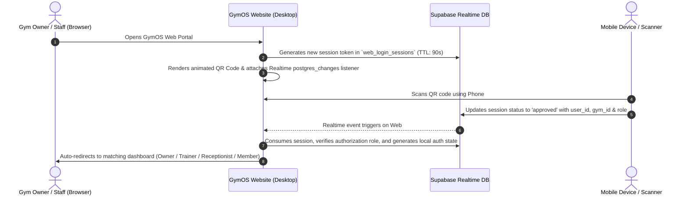

# GYM OS WEBSITES — Master Architecture, Exact Theme System & 100% Feature Parity Plan

## 1. Executive Summary & Core Rules
**GYM OS WEBSITES** provides a full-featured web portal with **100% feature parity** to the GymOS Flutter mobile application.
- **Rule 1 (Zero App Touch):** No changes will be made to any Flutter mobile application code files.
- **Rule 2 (Exact App Theme):** The website will use the exact same theme tokens, color palettes, border radii, shadows, and Google Fonts (`Inter`) from the Flutter app's `AppTheme`.
- **Rule 3 (WhatsApp Web-Style QR Login):** High-security dynamic QR code with a 90s expiring nonce. Scanned & approved via phone to instantly route to the corresponding dashboard.
- **Rule 4 (100% Feature Parity across all 4 Dashboards):**
  1. 👑 **Gym Owner Dashboard** (Dashboard, Members, Finance, Staff, More/Settings)
  2. 🏋️‍♂️ **Trainer Dashboard** (Clients, PT Sessions, Workouts, Diets, Requests, Salary)
  3. 📋 **Receptionist Dashboard** (Front Desk, Quick Admissions, Attendance Desk, Fee Collections)
  4. 🏃 **Member Portal** (Membership Card, Attendance, Workouts, Diets, Receipts, Profile)

---

## 2. Exact Theme Design Tokens (Extracted directly from `lib/core/theme/theme.dart`)

```css
:root {
  /* ── Primary Color System ── */
  --color-primary: #6C3AED;         /* Violet-700: GymOS Core Brand */
  --color-primary-light: #EDE9FE;   /* Violet-100: Soft badge/hover */
  --color-primary-dark: #5B21B6;    /* Violet-800: Active states */

  /* ── Surfaces ── */
  --color-background: #F8F8FA;      /* Clean neutral app background */
  --color-card-bg: #FFFFFF;         /* Pure white elevated cards */
  --color-surface-gray: #F3F4F6;    /* Gray-100: Subtle containers */

  /* ── Typography (Google Fonts 'Inter') ── */
  --color-text-primary: #111827;    /* Gray-900: Headlines, primary data */
  --color-text-secondary: #6B7280;  /* Gray-500: Subtitles, captions */
  --color-text-muted: #9CA3AF;      /* Gray-400: Placeholders, timestamps */

  /* ── Borders & Dividers ── */
  --color-border: #F0F0F2;          /* Subtle card borders */
  --color-divider: #F3F4F6;         /* Table & list separators */

  /* ── Semantic System ── */
  --color-success: #16A34A;         /* Green-600 */
  --color-success-light: #DCFCE7;   /* Green-100 */
  --color-warning: #F59E0B;         /* Amber-500 */
  --color-warning-light: #FEF3C7;   /* Amber-100 */
  --color-danger: #EF4444;          /* Red-500 */
  --color-danger-light: #FEE2E2;    /* Red-100 */
  --color-info: #3B82F6;            /* Blue-500 */
  --color-info-light: #DBEAFE;      /* Blue-100 */

  /* ── Corner Radii ── */
  --radius-card: 12px;
  --radius-button: 12px;
  --radius-input: 10px;
  --radius-chip: 20px;
  --radius-badge: 6px;
  --radius-sheet: 24px;

  /* ── Elevations & Shadows ── */
  --shadow-card: 0 2px 10px rgba(0, 0, 0, 0.03);
  --shadow-dropdown: 0 10px 25px -5px rgba(0, 0, 0, 0.08), 0 8px 10px -6px rgba(0, 0, 0, 0.04);
  --shadow-glow: 0 0 20px rgba(108, 58, 237, 0.25);
}
```

---

## 3. High-Security QR Login Workflow



---

## 4. 100% Feature Parity Breakdown (App vs Website)

### A. 👑 Gym Owner Dashboard
*Everything in the mobile app's 5 main tabs (`DashboardScreen`, `MembersScreen`, `FinanceScreen`, `StaffScreen`, `MoreScreen`):*
1. **Overview & Analytics:**
   - Active members count, today's check-ins, expiring memberships in next 7 days, monthly revenue, pending fees.
   - Attendance hourly distribution bar charts, Monthly income vs expense trends.
   - Real-time recent activity stream.
   - Multi-gym switcher (for owners with multiple branches).
2. **Member Management:**
   - Full member directory with search, status filters (Active, Expiring, Expired, Inactive).
   - "New Admission" modal (Name, phone, plan, batch, amount, payment method, biometric sync status).
   - Member Profile view (edit details, renew plan, attendance calendar, emergency freeze).
   - Export members list to CSV / Excel.
3. **Finance & Accounting:**
   - Total Revenue, Total Expenses, Net Profit calculations.
   - Transaction ledger with invoice/receipt printing.
   - "Add Expense" with category tagging (Rent, Electricity, Maintenance, Equipment).
   - Pending fee collection tracker with one-click WhatsApp reminder.
4. **Staff & Payroll:**
   - Staff directory categorized by role (Trainer, Receptionist, Cleaner, Manager).
   - Shift management (Shift 1 / Shift 2 assignment, late-mark rules).
   - Salary calculations (Monthly gross, advances deducted, leaves adjusted, commissions added).
   - Pay Salary Drafts & Salary Advance ledger.
5. **More & Settings:**
   - Biometric Device Integration (Device IP, heartbeat status, sync queue monitor).
   - Gym Profile & Branding (Logo, Gym name, contact, address).
   - Membership Plans & Packages configuration.
   - Gym Rules & Terms agreement settings.
   - GymOS SaaS Subscription management & direct web renewal (0% store cut).
   - Helpdesk tickets & support chat.

---

### B. 🏋️‍♂️ Staff Dashboard 1 — Trainer Portal
*Matching `lib/features/staff/portal`:*
1. **Trainer Home:** Today's appointments, assigned active PT clients, pending check-ins.
2. **My Clients:** Client profiles, goal weights, body measurement progress graphs (chest, waist, arms).
3. **Workout & Diet Assign:** Assign weekly routine templates, push day/pull day/leg day exercise logs.
4. **Leaves & Advance Requests:** Submit leave requests, request salary advance, view approval status.
5. **Salary & Earnings:** View pay slips, calculated personal training commissions, advance balances.

---

### C. 📋 Staff Dashboard 2 — Receptionist (Front Desk)
*Matching `lib/features/receptionist/portal`:*
1. **Front Desk Speed Center:**
   - Rapid search by member phone, name, or member ID.
   - Quick QR / manual check-in button with instant visual confirmation.
2. **Admissions & Fee Desk:**
   - Instant new member registration with immediate receipt generation.
   - Collect pending fees, partial payments, payment method selection (Cash / UPI / Card).
3. **Today's Collections:** Daily cash in hand counter, daily UPI counter, shift hand-over summary.
4. **Follow-ups & Inquiries:** Log walk-in inquiries, set follow-up dates.

---

### D. 🏃 Member Portal
*Matching `lib/features/member_app`:*
1. **Digital Gym Card:** Membership QR, validity counter, gym name, active plan badge.
2. **Attendance History:** Monthly calendar with check-in / check-out times and workout streak fire counter.
3. **Assigned Workouts & Diets:** Daily diet meals (calories, protein) and workout plan sets/reps.
4. **Payment Invoices:** Download official fee receipts for every payment made.

---

## 5. Implementation Roadmap

### Wave 1: Database Setup & QR Auth Gateway
- Create `web_login_sessions` table in Supabase with RLS & Realtime enabled.
- Build `index.html` with the **exact GymOS brand theme** (`#6C3AED`, `#F8F8FA`, `#111827`, Inter font).
- Build the dynamic QR component with countdown ring, pulse animations, and instant web-socket handshake.

### Wave 2: Gym Owner Master Dashboard
- Complete desktop layout (collapsible sidebar, header with gym switcher, main content area).
- Implement all 5 sections: Overview, Members, Finance, Staff, Settings.
- Connect live to Supabase tables (`gyms`, `members`, `finance_transactions`, `attendance`, `staff`).

### Wave 3: Receptionist & Trainer Portals
- Build Front Desk Speed Desk for Receptionist.
- Build Client Assignment & Progress tracker for Trainer.

### Wave 4: Member Portal & Receipt Engine
- Member personal dashboard with attendance calendar and receipt PDF download.

### Wave 5: Testing & Production Deployment
- End-to-end QR scan verification test with phone.
- Cross-browser QA and responsive desktop audit.
- Prepare deployment bundle for Netlify / Vercel.
